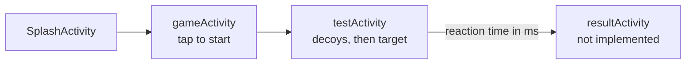

# Reaction-Guess_my_age

An Android reaction-time game. Icons fall down the screen, a Doge appears, and the app measures how fast you tap. The idea was to guess the player's age from that number.

## The problem

Reaction time slows with age in a fairly predictable way. I wanted to turn that into a party trick: tap once, and the phone guesses how old you are.

## What I built

The measurement half of that idea.

- A splash screen, then a start screen
- Five decoy icons fall for 4 seconds
- The Doge appears for a 3 second window, and the app records the time until you tap, in milliseconds
- The measured time is passed to a result screen

The result screen is empty. The age estimate was never built, so there is no model in this repo. Mapping the measured time to an age is the missing step.

## Architecture

Four activities chained by Intents, with no network and no storage.

## Design decisions

- Decoys before the target. Showing other icons first means the tap is a response to recognizing the Doge, not to "something appeared".
- A fixed 3 second response window, so a missed target ends the round instead of hanging.
- Animation and timing both run on `CountDownTimer`. The falling icons are moved by changing layout margins on each tick.

## Building

Android Gradle Plugin 7.0.2, Gradle 7.0.2, target SDK 30. Open it in Android Studio and accept the upgrade assistant, or build with JDK 11. No permissions or accounts needed.

## Limits

The reaction time is read from the countdown tick, not from the touch event's timestamp, so its resolution depends on the timer. A real version should use `SystemClock.elapsedRealtime()` at the moment the target is drawn and at the tap.
